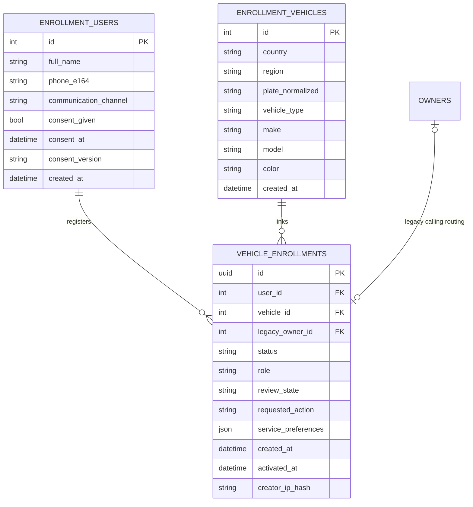

# Database schema and invariants



In SQLAlchemy, `VehicleEnrollment.id` is stored as a canonical 36-character UUID string to work identically in SQLite and PostgreSQL; generated with UUID version 4. Datetimes are naive UTC to match the upstream application's convention.

## PostgreSQL equivalent DDL (illustrative)

The actual, authoritative schema is in `app/enrollment/models.py`, created by `db.create_all()`.

```sql
CREATE TABLE enrollment_users (
  id SERIAL PRIMARY KEY,
  full_name VARCHAR(120) NOT NULL,
  phone_e164 VARCHAR(20) NOT NULL,
  communication_channel VARCHAR(16) NOT NULL,
  consent_given BOOLEAN NOT NULL DEFAULT FALSE,
  consent_at TIMESTAMP,
  consent_version VARCHAR(20) NOT NULL DEFAULT '2026-11',
  created_at TIMESTAMP NOT NULL
);
CREATE INDEX ix_enrollment_users_phone_e164 ON enrollment_users (phone_e164);

CREATE TABLE enrollment_vehicles (
  id SERIAL PRIMARY KEY,
  country VARCHAR(2) NOT NULL,
  region VARCHAR(12) NOT NULL,
  plate_normalized VARCHAR(12) NOT NULL,
  vehicle_type VARCHAR(20) NOT NULL,
  make VARCHAR(60) NOT NULL,
  model VARCHAR(60) NOT NULL,
  color VARCHAR(30) NOT NULL,
  created_at TIMESTAMP NOT NULL,
  CONSTRAINT uq_vehicle_plate UNIQUE (country, region, plate_normalized)
);

CREATE TABLE vehicle_enrollments (
  id VARCHAR(36) PRIMARY KEY,
  user_id INTEGER NOT NULL REFERENCES enrollment_users(id),
  vehicle_id INTEGER NOT NULL REFERENCES enrollment_vehicles(id),
  legacy_owner_id INTEGER UNIQUE REFERENCES owners(id),
  status VARCHAR(10) NOT NULL DEFAULT 'INACTIVE'
    CHECK (status IN ('INACTIVE', 'ACTIVE')),
  role VARCHAR(12) NOT NULL DEFAULT 'PRIMARY'
    CHECK (role IN ('PRIMARY', 'SECONDARY')),
  review_state VARCHAR(20) NOT NULL DEFAULT 'NONE',
  requested_action VARCHAR(10)
    CHECK (requested_action IS NULL OR requested_action IN ('SECONDARY', 'TRANSFER')),
  service_preferences JSON NOT NULL,
  created_at TIMESTAMP NOT NULL,
  activated_at TIMESTAMP,
  creator_ip_hash VARCHAR(64) NOT NULL
);
CREATE UNIQUE INDEX uq_active_primary_per_vehicle
ON vehicle_enrollments(vehicle_id)
WHERE status = 'ACTIVE' AND role = 'PRIMARY';
CREATE INDEX ix_vehicle_enrollments_creator_ip_hash ON vehicle_enrollments(creator_ip_hash);
CREATE INDEX ix_vehicle_enrollments_status ON vehicle_enrollments(status);
CREATE INDEX ix_vehicle_enrollments_user_id ON vehicle_enrollments(user_id);
CREATE INDEX ix_vehicle_enrollments_vehicle_id ON vehicle_enrollments(vehicle_id);
```

**Invariants:** A public QR is always the canonical `https://{configured-host}/v/{enrollment_uuid}`. Public scans must never expose direct phone numbers. New enrollments are `INACTIVE` with a null `activated_at`. Only a successful activation transaction assigns an `owners` link, marks `ACTIVE`, and fills `activated_at`. A transferred primary is marked `INACTIVE` and its legacy owner disabled. Repeated activation of an already active enrollment is idempotent. An unapproved conflict must fail with HTTP 409.
